  

 

## 🪐 Mission Briefing

> *I love building things that people actually use: web apps, mobile apps, and the ML that makes them smarter.*

- 🎓 Final-year **B.Tech in Computer Science & Engineering** at **Govt. Model Engineering College, Kochi**
- 📱 Happiest building with **React / Tailwind / Supabase** for web and **React Native / Redux** for mobile
- 🎨 Off-screen: drawing, painting, reading and pressed-flower art

 

## 🛰️ Missions

<table>
  <tr>
    <td width="50%" valign="top">

### 🎼 Noctune
**✅ Completed · Team of 6 · 6 months**

A music streaming platform with global search, playlists, **offline downloads** and **Spotify / YouTube Music sync**, built for smooth, seamless listening.

  </td>
    <td width="50%" valign="top">

### 🩺 Cure Connect
**✅ Completed · Team of 4 · 4 months**

A healthcare platform that predicts diseases from **symptom analysis**, matches donors and recipients by **HLA type**, and stores medical data efficiently.

  </td>
  </tr>
  <tr>
    <td width="50%" valign="top">

### 🏥 Nandana Surgicare
**✅ Delivered · Web Developer · 4 months**

Designed and deployed the company website: an **online catalogue** for medical and surgical products that strengthens their digital presence.

  </td>
    <td width="50%" valign="top">

### ⛓️ Scholar Chain
**🚧 In Progress · Final-year project · Team of 4**

An **AI-enhanced permissioned blockchain** framework for transparent, fraud-resistant scholarship distribution, with OCR + anomaly detection to flag altered certificates.

  </td>
  </tr>
</table>

 

## 🧰 Tech Arsenal

**🌐 Frontend & Mobile** 

**⚙️ Backend** 

**🗄️ Databases** 

**🧠 Machine Learning** 

**🛠️ Tools** 

 
<!--
## 🏅 Mission Log-->
<!--
| Year | Milestone |
| :--: | :-- |
| 🥈 **2026** | **2nd Prize**: District-Level AI Quiz for Learners, by Govt. MEC |
| 🌐 **2026** | **Web Admin**, MACS: managing the official college website |
| 🛰️ **2025** | Participated in **NASA International Space Apps Challenge**, Rajagiri School of Engineering & Technology |
| 💻 **2025** | Hackathons: **TINK-HER-HACK 3.0** (TinkerHub) and **.hack()** (MA College of Engineering) |
| 🔐 **Workshops** | Cyber Quest (Cybersecurity) and Unity Game Development, both at Govt. MEC |
-->
<!--  -->

## 📡 Transmit
 

 
  
 
✦ ✧ ✦ &nbsp; *Always exploring, always building.* &nbsp; ✦ ✧ ✦
 

 

